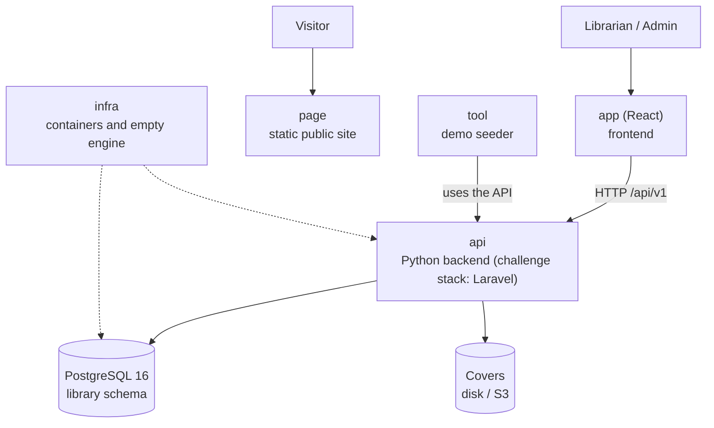

# Architecture at a glance — Manager Library

A five-minute read before opening everything else. The detail is in
[`architecture.md`](architecture.md).

## The system in one picture

## The six repositories and their role

| Repo | Role | Tested by |
|---|---|---|
| `docs` | The specification | Whether this reading is enough to build the system |
| `api` | Business rules and HTTP contract | Domain, application, contract and concurrency tests |
| `app` | Operator screens | An end-to-end walkthrough: login → lend → return → report |
| `page` | Public presentation, does not call the API | That it looks good on mobile and desktop |
| `infra` | `docker compose up` and the empty database | That it boots with a single command |
| `tool` | Demo data (books, members, loans) | That the demo at the fair has real data |

## The five ideas that hold up the design

1. **A loan is an immutable fact**; only a line's `returned_at` changes.
2. **Copies are withdrawn and restocked within the same operation** that creates or closes the line.
3. **Status is computed**: `open`, `overdue` or `closed` are not stored in the database.
4. **Frozen data does not follow the catalog**: October's report does not change because a book gets
   renamed in November.
5. **The database is the last line of defense**: if the copies `CHECK` trips, something wrote outside
   the system.
