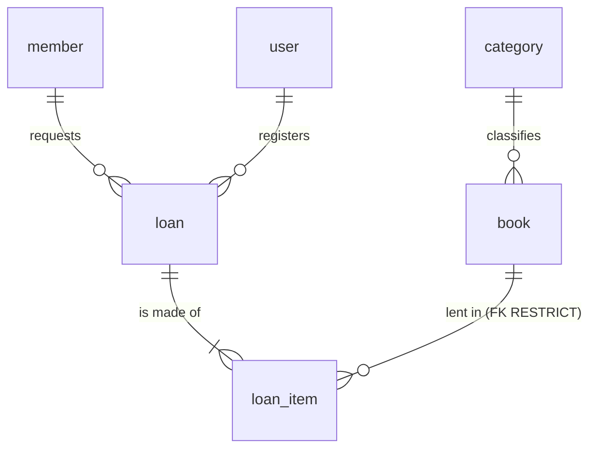

# Data model — Manager Library

**The only place where the data model lives.** Whoever implements this does not need to open the
code or connect to the engine to know what exists, of what type and under what rule.

- Reference engine: PostgreSQL 16. Schema `library`. Server in UTC.
- Governed by [`constitution.md`](constitution.md) and [`spec.md`](spec.md). If anything contradicts
  this document, this document wins.

Each rule carries one of **three marks**: **engine** (enforced by the database), **domain only**
(only the code), **pending (T-xx)** (set by that task in [`tasks.md`](tasks.md)).

---

## 0. Naming convention

| Element | Convention | Example |
|---|---|---|
| Table | `snake_case`, English, **singular** | `loan_item` |
| Column | `snake_case`, English, singular, ASCII | `due_at` |
| Hand-written constraint | `ck_{table}_{rule}` | `ck_book_available_range` |
| Schema | `library` | `library.loan` |

`user` is written `library."user"` in hand-written SQL; the ORM quotes it on its own.

## 1. Glossary

| Term | Definition | Lives in |
|---|---|---|
| **Book** | A catalog title, with author, ISBN, category, copies and optional cover | `book` |
| **Category** | One of five fixed classifications, seeded, no maintenance | `category` |
| **Copy** | A physical copy of a book. Counted, not identified | `book.total_copies`, `book.available_copies` |
| **Member** | A person who borrows. Never logs in | `member` |
| **Loan** | A consummated fact: who requested it, who registered it and when | `loan` |
| **Loan line** | One book within a loan, with its due date and its return | `loan_item` |
| **Loan status** | `open`, `overdue` or `closed`. **Computed, not stored** | no column |
| **User** | Internal operator with role `admin` or `librarian` | `user` |
| **Frozen** | A copy of the value at the instant of the loan; does not follow the catalog | `loan_item.book_title`, `isbn`, `category_name` |

## 2. Entities and relationships



Six entities, six tables. There is no report table, no fines table, no audit table.

## 3. Physical model

No column carries a `DEFAULT`: the domain sets every value.

**`category`** — read-only seed.

| Column | Type | Nullable | Note |
|---|---|---|---|
| `id` | `uuid` | no | PK. Literal identifiers (see §9) |
| `name` | `varchar(120)` | no | Unique |

**`book`**

| Column | Type | Nullable | Note |
|---|---|---|---|
| `id` | `uuid` | no | PK |
| `title` | `varchar(250)` | no | Trimmed by the domain |
| `author` | `varchar(200)` | no | |
| `isbn` | `char(13)` | no | Digits only. Unique among active books (partial index) |
| `category_id` | `uuid` | no | Restricting FK to `category` |
| `total_copies` | `integer` | no | ≥ 1 |
| `available_copies` | `integer` | no | Between 0 and `total_copies` |
| `cover_key` | `varchar(512)` | **yes** | Opaque key; never a path or bytes; never an empty string |
| `deleted_at` | `timestamptz` | yes | Soft delete. Null = active |

**`member`**

| Column | Type | Nullable | Note |
|---|---|---|---|
| `id` | `uuid` | no | PK |
| `full_name` | `varchar(200)` | no | |
| `document_number` | `varchar(30)` | no | Unique |

**`loan`**

| Column | Type | Nullable | Note |
|---|---|---|---|
| `id` | `uuid` | no | PK |
| `member_id` | `uuid` | no | Restricting FK to `member` |
| `loaned_by_user_id` | `uuid` | no | Restricting FK to `user` |
| `loaned_at` | `timestamptz` | no | Instant of the loan |

**`loan_item`**

| Column | Type | Nullable | Note |
|---|---|---|---|
| `id` | `uuid` | no | PK |
| `loan_id` | `uuid` | no | FK with `ON DELETE CASCADE` |
| `book_id` | `uuid` | no | Restricting FK to `book` |
| `book_title` | `varchar(250)` | no | Frozen; same width as `book.title` |
| `isbn` | `char(13)` | no | Frozen |
| `category_name` | `varchar(120)` | no | Frozen; **no FK on purpose** |
| `due_at` | `timestamptz` | no | `loaned_at` + 14 days, computed by the domain |
| `returned_at` | `timestamptz` | **yes** | Null while not returned |

**`user`**

| Column | Type | Nullable | Note |
|---|---|---|---|
| `id` | `uuid` | no | PK |
| `username` | `varchar(120)` | no | Unique, lowercase, trimmed |
| `password_hash` | `varchar(512)` | no | Never indexed |
| `role` | `varchar(40)` | no | `admin` or `librarian` |

Cross-cutting rules: **every timestamp is `timestamptz`**; **there are no audit columns**
(`created_at`/`updated_at`) because no requirement asks for them.

## 4. Constraints and indexes: where each rule lives

| Rule | Object | Mark |
|---|---|---|
| Primary keys of the six tables | `PK_*` | **engine** |
| `category.name` unique | unique index | **engine** |
| `member.document_number` unique | unique index | **engine** |
| `user.username` unique | unique index | **engine** |
| `isbn` unique among active rows | partial unique index `WHERE deleted_at IS NULL` | **engine** |
| `book.category_id` → `category.id` RESTRICT | FK | **engine** |
| `loan.member_id` → `member.id` RESTRICT | FK | **engine** |
| `loan.loaned_by_user_id` → `user.id` RESTRICT | FK | **engine** |
| `loan_item.loan_id` → `loan.id` CASCADE | FK | **engine** |
| `loan_item.book_id` → `book.id` RESTRICT | FK | **engine** |
| `0 <= available_copies <= total_copies` | `ck_book_available_range` | **engine** — last line of defense for concurrency |
| `total_copies >= 1` | `ck_book_total_positive` | **pending (T-18)** · domain only today |
| Unique `(loan_id, book_id)` | unique index | **engine** |
| `role` in (`admin`,`librarian`) | `ck_user_role` | **pending (T-18)** · domain only today |
| Maximum 3 unreturned per member | — | **domain only** (not expressible as a `CHECK`) |
| A member with overdue items cannot borrow | — | **domain only** |
| Withdrawing a copy and creating the line are one operation | — | **domain only** (one transaction) |
| A loan has 1 to 3 lines | — | **domain only** |
| Loans and returns are immutable except `returned_at` | — | **domain only** (by absence of an operation) |

Access indexes: `book (category_id, title)` partial over active rows; `loan (loaned_at)`;
`loan_item (book_id)`; `loan_item (due_at) WHERE returned_at IS NULL` for overdue items.

## 5. Foreign key policy

| # | FK | `ON DELETE` | Why |
|---|---|---|---|
| FK-1 | `book.category_id` | RESTRICT | A category with books is not deleted |
| FK-2 | `loan_item.loan_id` | CASCADE | Composition: the line does not live without its loan (never fires: loans are never deleted) |
| FK-3 | `loan_item.book_id` | RESTRICT | Last-resort barrier: a manual delete cannot orphan the history |
| FK-4 | `loan.member_id` | RESTRICT | The member of a loan does not disappear |
| FK-5 | `loan.loaned_by_user_id` | RESTRICT | Authorship is accounting data |

`ON UPDATE NO ACTION` on all of them: the keys are application UUIDs and do not change.

## 6. Access patterns

| # | Pattern | Frequency |
|---|---|---|
| Q1 | Search books (text, category, active, ordered by title, paginated) | High |
| Q2 | Book by id | High |
| Q3 | Books by a batch of ids (before lending) | High, a contention point |
| Q4 | List categories | High |
| Q5 | A loan with its lines | Medium |
| Q6 | Loans by range, status and member | High |
| Q7 | A member's unreturned lines (count and overdue) | High, on every loan |
| Q8 | Global overdue items | Medium |
| Q9 | Report: most borrowed by range | High, the most expensive |
| Q10 | User by username | High, on every login |

## 7. Privacy and retention

| Table | Attribute | Classification | Handling |
|---|---|---|---|
| `user` | `username` | Personal data | Restricted access |
| `user` | `password_hash` | **Secret** | Never in logs or responses; never indexed |
| `member` | `full_name`, `document_number` | **Personal data** | `admin` and `librarian` only; **never** in the report or in public endpoints |
| `loan`, `loan_item` | all | Commercial; `member_id` is indirect personal data | Indefinite retention |
| `book`, `category` | all | Public | Soft delete / no deletion |

The report aggregates by book: **it exposes neither members nor librarians.**

**Retention:** loans and lines are never deleted; books only get a soft delete; the cover binary is
the **only** data that is physically deleted. Mandatory order: `cover_key` is nulled and the
transaction is committed first; the binary is deleted afterward.

## 8. Auditing

The system carries no `created_at`/`updated_at`. Business instants already have a column:
`loan.loaned_at`, `loan_item.returned_at` and `book.deleted_at`. If a question like "who changed this
title?" comes up, the decision goes back to the owner.

## 9. Seed strategy

The **five categories** go in the initial migration, with fixed identifiers. `name` is user-facing
data, so it stays in Spanish (Article XI):

| `id` | `name` |
|---|---|
| `11111111-1111-4111-8111-111111111111` | Novela |
| `22222222-2222-4222-8222-222222222222` | Ciencia |
| `33333333-3333-4333-8333-333333333333` | Tecnología |
| `44444444-4444-4444-8444-444444444444` | Historia |
| `55555555-5555-4555-8555-555555555555` | Infantil |

The **initial administrator is not seeded by the database**: the application boot creates it from
environment credentials, because only the hashing port can produce the hash. The demo data seeder
(`tool`) uses the **API**, never direct SQL.

## 10. How this document is checked against reality

```sql
-- Must return the columns from §3, with no DEFAULT at all
SELECT table_name, ordinal_position, column_name, data_type, is_nullable, column_default
FROM information_schema.columns WHERE table_schema = 'library' ORDER BY 1, 2;

-- Constraints: PK, FK and CHECK
SELECT c.conrelid::regclass, c.conname, c.contype, pg_get_constraintdef(c.oid)
FROM pg_constraint c JOIN pg_namespace n ON n.oid = c.connamespace
WHERE n.nspname = 'library' ORDER BY 1, 3, 2;

-- Indexes
SELECT tablename, indexname, indexdef FROM pg_indexes WHERE schemaname = 'library' ORDER BY 1, 2;
```

If a rule marked **engine** does not show up, someone removed it. If a rule marked **domain only**
shows up, it has already been pushed down and needs to be reclassified. The engine wins: the document
is broken and the document gets fixed.
